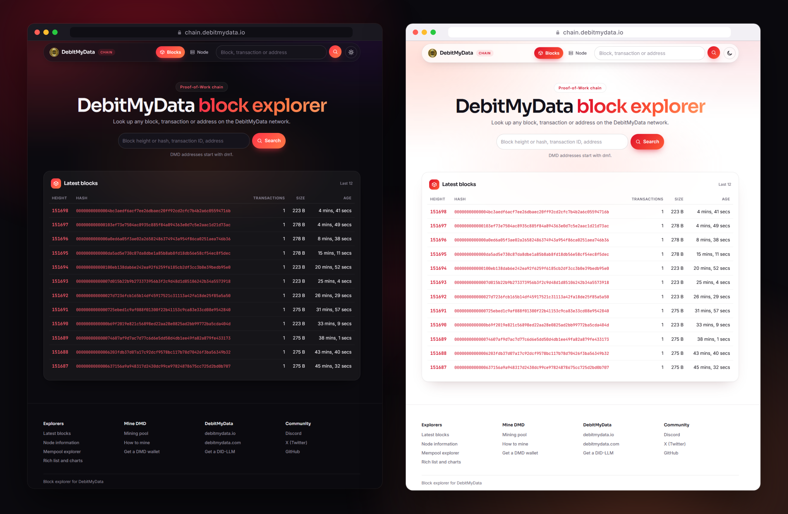

# DebitMyData Lite Explorer

A small, fast block explorer for the DebitMyData Proof-of-Work chain, live at
[chain.debitmydata.io](https://chain.debitmydata.io/). It is a single Go program that reads the
chain straight from a DebitMyData node: no database, no indexer, nothing to sync. It starts in a
second and shows the chain as the node sees it.

## What it shows

- **Latest blocks:** the 12 newest blocks, with their height, hash, transactions, size and age.
- **Blocks:** header details and every transaction in the block.
- **Transactions:** inputs and outputs with their addresses and amounts in DMD (the native
  DebitMyData coin), the block that holds them and the number of confirmations, plus any
  `OP_RETURN` data.
- **Addresses:** `dm1...` (SegWit) and `D...` (legacy) addresses, with their balance and unspent
  coins, found on request from the chain's unspent coins (about a minute).
- **Node information:** the chain, block count, difficulty, node version and connections.
- **Search** by block height, block hash, transaction ID or address.
- **Light and dark themes**, remembered per browser, in DebitMyData's Aurora design. Fonts and
  icons are served by the explorer itself: the pages load nothing from other sites.

## Why a lite explorer

The bigger explorers keep their own copy of the chain in a database, which takes hours to build
and a server to hold. This one keeps nothing: every page is read from the node when it is asked
for. It runs next to any DebitMyData node with very little memory, and it is the quickest way to
check what a node holds.

## Safe by design

- **Read only.** It uses seven read-only RPC calls (`getblockchaininfo`, `getnetworkinfo`,
  `getblockhash`, `getblock`, `getrawtransaction`, `validateaddress`, `scantxoutset`), and
  never touches a wallet.
- **No secrets in the code.** The node's login comes from the server's settings, never from this
  repository.
- **Nothing from other sites** in its pages, and the node's RPC stays private, behind the explorer.

## Other DebitMyData explorers

- [Mempool explorer](https://mempool.debitmydata.io/): the mempool, fees and mining pools.
- [Rich list and API](https://explorer.debitmydata.io/): the rich list, charts and a public API.

## Installation

To run it next to a DebitMyData node of your own, see **[INSTALL.md](INSTALL.md)**.

## Links

[debitmydata.io](https://debitmydata.io/) · [debitmydata.com](https://debitmydata.com/) ·
[Mining pool](https://pool.debitmydata.io/) · [Get a DID-LLM](https://id.debitmydata.io/) ·
[Discord](https://discord.gg/PSK436rP4Y) · [X](https://x.com/debitmydataPOW)

## License

[MIT](LICENSE). The fonts in `static/fonts` (Inter, JetBrains Mono, Mada and Sora) are under
the SIL Open Font License; their license texts are next to them.
